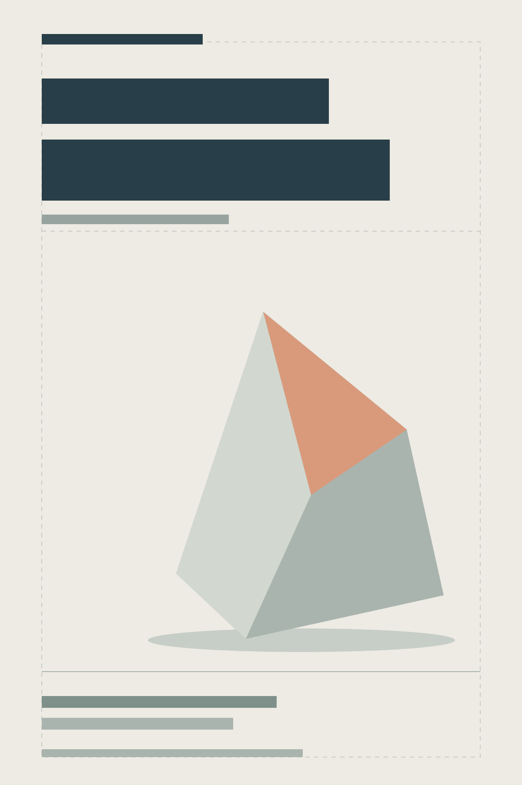
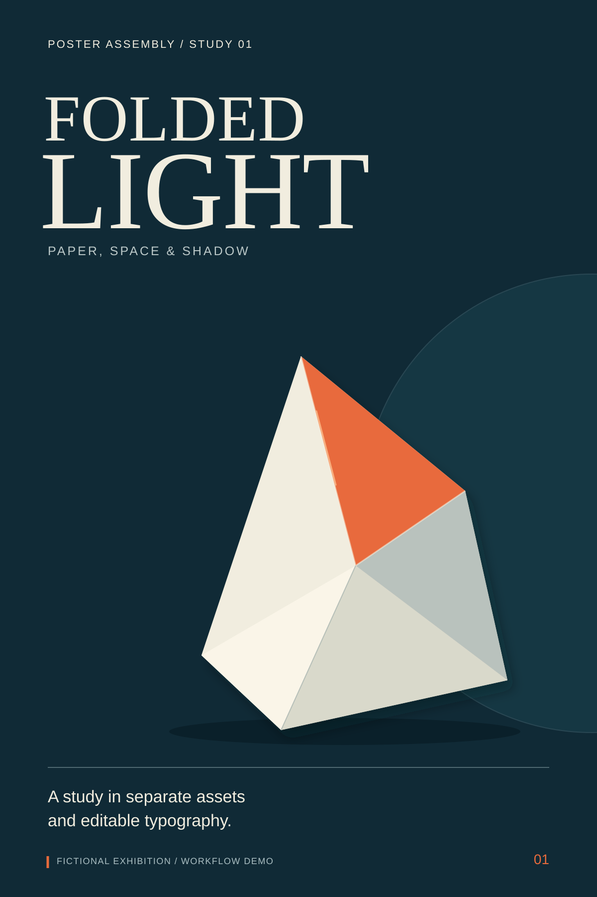

# Folded Light / 纸与光：工作流演示

[Project home](../../README.md) · [项目首页](../../README.zh-CN.md)

This fictional exhibition study shows the workflow's artifacts without requiring an image model or a paid generation call. The vector shapes were authored for this repository; no AI image-generation output, real exhibition, brand, or client result is claimed.

这是一个虚构纸艺展的流程示例。图形为本项目制作的矢量素材，用于说明独立素材和文字如何组装；没有调用生图模型，也不代表真实展览、品牌或客户案例。

## 1. Brief / 需求

Read [brief.md](brief.md) for the use case, target dimensions, copy, visual direction, and acceptance criteria. All text is demonstration content; no invented dates, venue, or sign-up URL is presented as real.

需求、输出尺寸、文案、风格及验收条件见 [brief.md](brief.md)。不加入看似真实但不存在的展期、地点或报名链接。

## 2. Layout reference / 布局参考

[Editable reference / 可编辑参考图](layout.svg)

The reference uses blocks and a silhouette to reserve space. It contains no text or fake QR code. In an actual image-production task, the user would review this composition before high-resolution generation.

参考图用色块与轮廓表达位置，不含文字或伪二维码。真实生图任务应在此确认构图，再进入高清素材制作。

## 3. Independent artwork / 独立素材

| Asset / 素材 | SVG source / 源文件 | Nominal canvas / 尺寸 |
|---|---|---|
| Background / 背景 | [background.svg](assets/background.svg) | 1200 × 1800 |
| Paper form / 纸雕主体 | [hero.svg](assets/hero.svg) | 780 × 960, transparent outside the form / 主体之外透明 |

The source assets contain no text. SVG artwork is scalable; the dimensions above describe its coordinate system, not an image model's native output. Export PNG copies from the SVG files in your editor when raster files are needed.

素材不含文字；SVG 为可缩放矢量，上述尺寸描述其坐标系统，不是模型原生出图能力的声明。需要位图时，可在编辑器中从 SVG 导出 PNG。

## 4. Assembly / 拼接参数

Canvas: 1200 × 1800, top-left origin, units in canvas pixels. / 画布 1200 × 1800，左上角原点，单位为画布像素。

| Layer / 图层 | Position / 位置 | Size / 尺寸 | Treatment / 处理 |
|---|---|---|---|
| Background | x=0, y=0 | 1200 × 1800 | Full canvas, no crop / 铺满，无裁切 |
| Hero | x=285, y=535 | 780 × 960 | Keep aspect ratio and transparent exterior / 保持比例和透明背景 |
| Typography | Separate `typography` group / 独立文字组 | See SVG / 见源图 | Editable text, system serif/sans fallbacks / 可编辑文字及系统字体回退 |

The final [poster.svg](poster.svg) embeds the actual background and hero artwork directly as groups; it does not depend on external image links. Text is kept in a separate group. Open the SVG in an editor that preserves text and groups; font appearance can vary across systems.

最终 SVG 将这两份素材的图形直接内嵌为组，没有外部图像依赖；文字使用独立组。可在支持保留文字与分组的编辑器中打开，字体外观可能因系统回退不同而变化。

## 5. Result and checks / 结果与检查

[Editable poster / 可编辑排版结果](poster.svg)

- Composition, artwork, and typography are separate artifacts. / 构图、素材和文字分别提供。
- The hero SVG has a transparent exterior with no painted checkerboard; preserve transparency when exporting a PNG. / 主体 SVG 外部透明，不含棋盘格图案；导出 PNG 时保留透明背景。
- The final SVG contains editable text and named artwork groups. / 最终 SVG 保留文字与命名图形组。
- The example is a screen demonstration; no print bleed, printer profile, or QR scanning result is claimed. / 示例用于屏幕演示，未声称完成印刷出血、印厂配置或扫码测试。
- The workflow stage requiring user approval is illustrated, not recorded as an actual client approval. / 示例说明确认环节，不伪造真实客户审批记录。

The example files are distributed under the repository's [MIT License](../../LICENSE).
